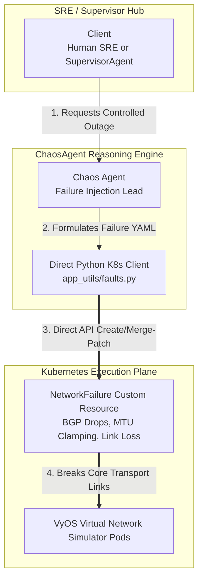

# Network Chaos Agent (`chaosagent`)

## ⚡ Overview & SRE Persona
The **`chaosagent`** is an elite Chaos Engineering specialist and automated SRE adversary. 

Deployed as a standalone **Google Cloud Vertex AI Reasoning Engine**, its mission is to inject highly disciplined, severe physical and virtual network degradation directly into your active cluster. This provides the controlled stress stimulus required to test root-cause analysis (RCA) pipelines and autonomous self-healing loops.

---

## 🏛️ Technical Architecture & Cloud Identity
*   **Framework**: Built on Google ADK (`google-adk`)
*   **Target Cloud Engine ID**: `projects/YOUR_PROJECT_ID/locations/YOUR_GCP_REGION/reasoningEngines/YOUR_CHAOS_ENGINE_ID`
*   **Coordination Model**: Operates non-A2A (`is_a2a: false`). Bypassing central MCP servers entirely, it uses highly secure, authenticated direct Python Kubernetes client libraries (`k8s.py`) to manage declarative `NetworkFailure` custom resources.

---

## 🛠️ Tooling Specification (Direct K8s API)

The agent utilizes custom Python functions exported from `app_utils/faults.py` to directly interact with the Kubernetes cluster extension API (`google.dev/v1`):

1.  **`getFaultDescriptors()`**: Retrieves all registered Kubernetes Custom Resource Definition (CRD) schemas labeled with `type=failure,agent-accessible=true`.
2.  **`getDeployedFaults()`**: Queries the `network` namespace to retrieve full live JSON specifications of all active chaos injections.
3.  **`deploySpec(descriptor)`**: Applies a structured `NetworkFailure` dictionary to Kubernetes. If the fault already exists, it intelligently executes an HTTP `409` merge-patch (`application/merge-patch+json`) update.
4.  **`deleteFault(kind, name)`**: Fully removes an active fault descriptor by name, allowing the network simulator to begin auto-restoration.
5.  **`getFailureAnalysis()`** / **`getInfrastructure()`**: Retrieves internal architectural docs detailing physical underlay links and VRF routing topologies.

---

## 📐 Scope of Injectable Chaos

The agent is empowered to simulate severe enterprise telecommunications outages:
*   **Protocol Flaps**: Forcing sudden BGP session drops or OSPF adjacency dead timer expirations.
*   **Transport Corruption**: Injecting artificial packet corruption, transmission queue latency starvation, or artificial jitter.
*   **MTU Clamping**: Introducing severe MTU size mismatches across core provider (`P`) routers to induce silent packet fragmentation drops.

---

## 🎨 Gemini Enterprise Branding Frontmatter
*   **Display Name**: `Network Chaos`
*   **Icon URI**: `https://storage.googleapis.com/${GCP_PROJECT}-agent-assets/telco_icon.jpg`
*   **Primary Tool Summary**: *"Inject controlled network failures, link outages, packet corruption, MTU mismatch, and BGP session drops."*
