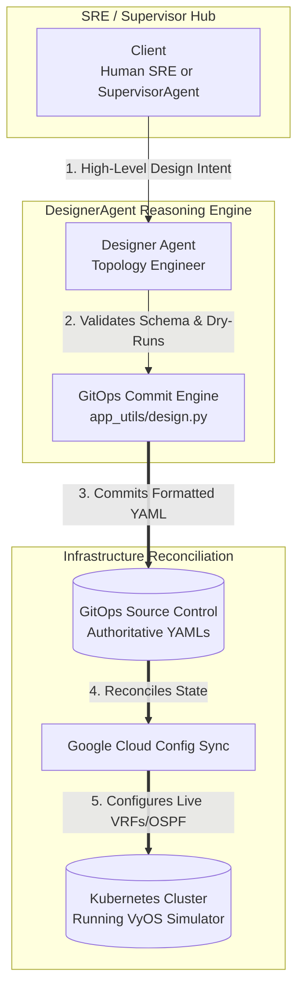

# Network Designer Agent (`designeragent`)

## 🛠️ Overview & SRE Persona
The **`designeragent`** acts as your elite Infrastructure SRE and MPLS/L3VPN Network Architect. 

Deployed as a standalone **Google Cloud Vertex AI Reasoning Engine**, its primary mission is to translate high-level network design intent into declarative Kubernetes Custom Resource Definitions (`VyOSInfrastructure`, `VyOSUnderlay`, `VyOSL3VPN`) and deploy them safely via GitOps or direct cluster apply.

---

## 🏛️ Technical Architecture & Cloud Identity
*   **Framework**: Built on Google ADK (`google-adk`)
*   **Target Cloud Engine ID**: `projects/YOUR_PROJECT_ID/locations/YOUR_GCP_REGION/reasoningEngines/YOUR_DESIGNER_ENGINE_ID`
*   **Coordination Model**: Operates non-A2A (`is_a2a: false`). It enforces authoritative design rules by committing fully validated YAML specifications directly to a GitOps repository (`git.py`), relying on Google Cloud Config Sync to reconcile the desired state into the active cluster.

---

## 🛠️ Tooling Specification (GitOps & K8s)

The agent employs a powerful hybrid toolset combining GitOps file management with direct Kubernetes validation:

1.  **`getDesignDoc()`**: Retrieves authoritative architectural documentation (`designdoc.md`) enforcing IP addressing (IPAM) schemes, Route Distinguisher (RD) allocations, and naming conventions.
2.  **`getVyosDescriptors()`**: Retrieves complete OpenAPI CRD schemas for physical routers (`VyOSInfrastructure`), core routing (`VyOSUnderlay`), and customer VPNs (`VyOSL3VPN`).
3.  **`getDeployedCRs()`**: Retrieves full existing live configurations of all deployed cluster network resources to ensure updates merge cleanly.
4.  **`deployDescriptor(descriptor_yaml)`**: Parses raw YAML specifications, executes an authenticated server-side apply dry-run (`dry_run="All"`) against Kubernetes to verify schema validity, and commits the formatted YAML directly to GitOps.
5.  **`deploySpec(dict)`** / **`deleteSpec(kind, name)`**: Direct K8s API fallback execution wrappers.

---

## 🔄 Core Engineering Logic

The `designeragent` follows a strict SRE golden rule: **PREFER UPDATING EXISTING CRs** over creating new ones from scratch. 
*   If instructed to add a new customer VRF or peering link to an existing Provider Edge (`pe1`) router, it pulls the active deployed YAML retrieved from `getDeployedCRs()`, appends the new interface sub-blocks, and commits a clean merge update.

---

## 🎨 Gemini Enterprise Branding Frontmatter
*   **Display Name**: `Network Designer`
*   **Icon URI**: `https://storage.googleapis.com/${GCP_PROJECT}-agent-assets/telco_icon.jpg`
*   **Primary Tool Summary**: *"Translate high-level network design intent into ordered Kubernetes CRD operations and modify MPLS/L3VPN topologies."*
