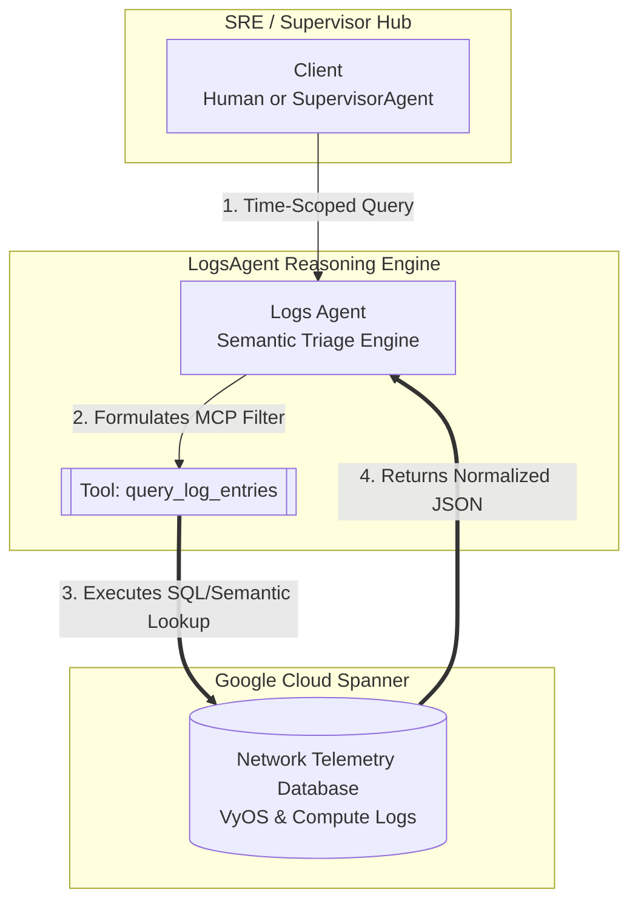

# Network Logs Agent (`logsagent`)

## 🔎 Overview & SRE Persona
The **`logsagent`** serves as the automated observability triage expert inside your Gemini Enterprise telecommunications layout. 

Deployed as a standalone **Google Cloud Vertex AI Reasoning Engine**, its primary mission is to act as an intelligent semantic layer over massive, disparate network telemetry databases—extracting precise error sequences, routing state transitions, and kernel hardware alarms without overwhelming human operators.

---

## 🏛️ Technical Architecture & Cloud Identity
*   **Framework**: Built on Google ADK (`google-adk`)
*   **Target Cloud Engine ID**: `projects/YOUR_PROJECT_ID/locations/YOUR_GCP_REGION/reasoningEngines/YOUR_DETECTIVE_ENGINE_ID`
*   **Coordination Model**: Operates cleanly as `is_a2a: false`. It interconnects **stigmergically** by querying underlying Cloud Spanner log registries populated by the active network simulator VMs (`VyOS` / compute instances).



---

## 🛠️ Tooling Specification (`MCPToolset`)

The agent connects directly to your central Cloud Run MCP tool server, exposing exactly one highly specialized capability:

### `query_log_entries`
*   **Description**: Performs keyword searches over log contents and sources within optional time windows and severity thresholds.
*   **Input Signatures**:
    *   `time_period` (Optional): Normalized time string ranges (`YYYY-MM-DD HH:MM:SS`) or relative plain English inputs (*"last 15 minutes"*, *"yesterday between 14:00 and 15:00"*).
    *   `severity` (Optional): Comma-separated severity thresholds (`INFO`, `WARNING`, `ERROR`, `CRITICAL`, `DEBUG`).
*   **Output Schema**: Returns a list of structured JSON objects representing critical log occurrences:
    ```json
    {
      "timestamp": "2026-06-08T11:43:59Z",
      "severity": "CRITICAL",
      "source": "pe2:ospfd",
      "message": "OSPF neighbor 10.0.0.4 dead timer expired; adjacency lost",
      "details": "Interface eth2 line protocol went down"
    }
    ```

---

## 🔄 Operational Triage Capabilities

The `logsagent` excels at processing complex natural language time references and converting them into strict database parameters:
1.  **Relative Windows**: Translates *"over the past 2 hours"* or *"this week"* into dynamic timestamps relative to active UTC time.
2.  **Output Capping**: Automatically enforces a strict ceiling of **30 log entries** per output turn to prevent context window saturation. If more entries exist, it instructs the user exactly how to narrow the time scope.

---

## 🎨 Gemini Enterprise Branding Frontmatter
*   **Display Name**: `Network Logs`
*   **Icon URI**: `https://storage.googleapis.com/${GCP_PROJECT}-agent-assets/telco_icon.jpg`
*   **Primary Tool Summary**: *"Answer questions about network agent logs, search error entries, and analyze log trends."*
