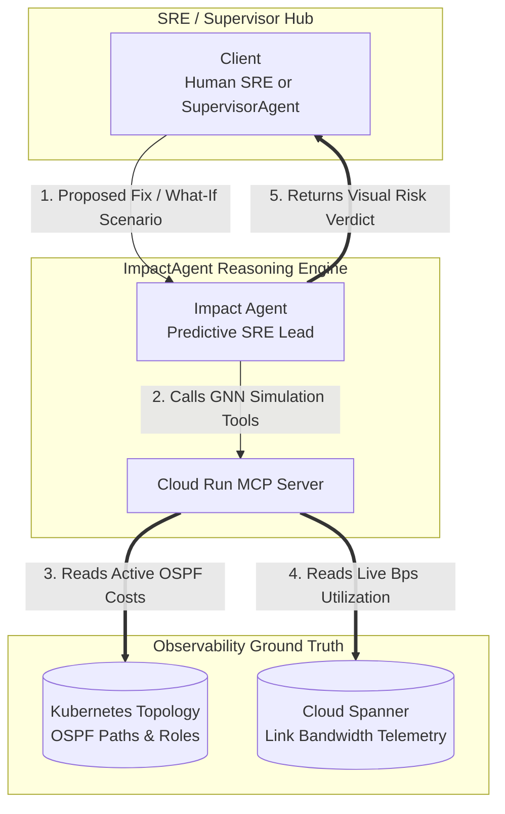

# Network Impact Assessment Agent (`impactagent`)

## 🔮 Overview & SRE Persona
The **`impactagent`** functions as your automated technical risk assessor and predictive capacity planning lead. 

Deployed as a standalone **Google Cloud Vertex AI Reasoning Engine**, its core responsibility is to inspect ground-truth network state and execute advanced machine learning / Graph Neural Network (GNN) blast-radius simulations before proposed design changes or remediation steps are committed to live hardware.

---

## 🏛️ Technical Architecture & Cloud Identity
*   **Framework**: Built on Google ADK (`google-adk`)
*   **Target Cloud Engine ID**: `projects/YOUR_PROJECT_ID/locations/YOUR_GCP_REGION/reasoningEngines/YOUR_IMPACT_ENGINE_ID`
*   **Coordination Model**: Operates non-A2A (`is_a2a: false`). It connects directly to your central Cloud Run MCP tool server to query active telemetry from Cloud Spanner and verify topology state.

---

## 🛠️ Tooling Specification (`MCPToolset`)

The agent combines powerful structural queries with ML-driven forecasting tools:

1.  **`query_router_metadata(names)`**: Identifies authoritative router hierarchy roles (`P` Core vs `PE` Edge vs `RR` Route Reflector).
2.  **`query_ospf_paths(source, dest, exclude_link)`**: Traces active OSPF routing paths, calculating dynamic link costs based on reference bandwidths ($10G \rightarrow 1, 1G \rightarrow 10$). Can exclude specific interfaces to simulate link loss.
3.  **`query_link_utilization(names)`**: Retrieves active bandwidth saturation metrics (bps) to establish ground truth before calculating shifts.
4.  **`query_affected_flows(router_names)`**: Pinpoints all live user end-to-end sessions traversing specific network nodes, each reported with the throughput, packet loss and latency it is *measuring* alongside the bandwidth it *requested*.
5.  **`query_flow_metrics(flow_names, window_minutes)`**: Per-direction measured throughput, loss, latency and jitter for a named flow — a bidirectional test has a forward and a reverse leg and they can differ.
6.  **`simulate_remediation_impact(action, router, interface, ...)`**: Executes complete machine learning / GNN impact simulations for proposed link reboots or OSPF restorations.
7.  **`simulate_traffic_addition(source, dest, bps)`**: Forecasts congestion bottlenecks before adding new high-volume flows.
8.  **`identify_bottlenecks(threshold)`** / **`recommend_capacity_upgrades(links)`**: Surfaces all links exceeding 50% utilization and formulates concrete hardware upgrade paths ($1G \rightarrow 10G$).

> The authority on what this agent can actually call is the `tool_filter` in `app/agent.py`, not
> this list. Items 1–3 and 6 are documented capability that is not currently wired in.

---

## 🚦 Structured Executive Verdicts

The `impactagent` enforces strict technical governance by concluding every risk analysis with professional Markdown risk badges (✅ LOW RISK, ⚠️ MEDIUM RISK, ❌ HIGH RISK) and a definitive machine-parsable executive verdict:
*   `PROCEED`
*   `PROCEED WITH CAUTION`
*   `CAPACITY_UPGRADE_NEEDED`
*   `DO NOT PROCEED`

---

## 🎨 Gemini Enterprise Branding Frontmatter
*   **Display Name**: `Network Impact Assessment`
*   **Icon URI**: `https://storage.googleapis.com/${GCP_PROJECT}-agent-assets/telco_icon.jpg`
*   **Primary Tool Summary**: *"Analyze network blast radiuses, simulate what-if OSPF/link remediations, predict traffic flow impacts, and recommend capacity upgrades."*
