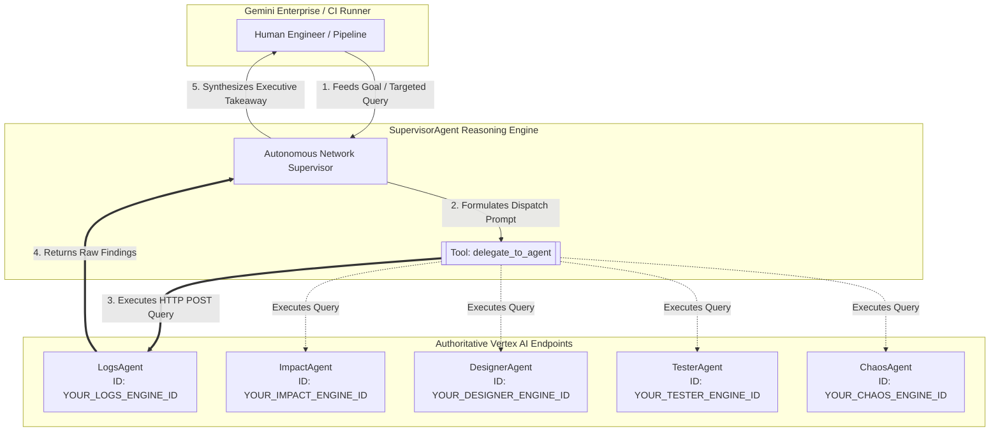
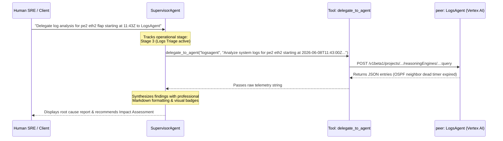

# Autonomous Network Supervisor Agent (`supervisoragent`)

## 🌐 Overview & Core Mission
The **`supervisoragent`** is an elite autonomous operations orchestrator and dynamic multi-agent dispatcher deployed as a self-contained **Google Cloud Vertex AI Reasoning Engine** (built on the Google ADK).

Its primary mission is to take overarching technical objectives or custom troubleshooting instructions (e.g., *"Analyze system logs on pe2 for interface eth2 flaps"*) and programmatically route them across your specialized AI agent team in real time.

---

## 🏛️ Upgraded Architecture (Dynamic Multi-Agent Dispatch)

While deployed standalone (`is_a2a: false`), the Supervisor has been upgraded with **direct programmatic delegation capabilities**. 

Rather than forcing human engineers to manually copy-paste prompts between chat windows, the Supervisor is equipped with an authenticated internal dispatch tool (`delegate_to_agent`) that communicates directly with peer Vertex AI Reasoning Engines over secure HTTP REST endpoints.

---

## 🛠️ Complete Active Toolset

The Supervisor combines high-level infrastructure observability with direct peer-agent control:

1.  **`delegate_to_agent(agent_name, instruction)`**:
    *   **Capability**: Directly queries a peer Reasoning Engine (`logsagent`, `impactagent`, `designeragent`, `testeragent`, `chaosagent`) by mapping its shortname to its authoritative cloud engine ID.
    *   **Mechanism**: Acquires live OAuth Bearer tokens and executes an HTTP POST query against Vertex AI in real time.
2.  **`query_fault_events`** (`MCPToolset`):
    *   **Capability**: Instantly retrieves active physical or virtual network hardware alarms from the central MCP tool server.
3.  **`getRunningTests`** (`MCPToolset`):
    *   **Capability**: Inspects active synthetic traffic workloads (`TrafficTest` CRDs) running across cluster devices.

---

## 🔄 Flexible Operations vs. Rigid Triage Loops

While the Supervisor fully tracks the standard **5-Step Stigmergic RCA Loop** (`Chaos` $\rightarrow$ `Tester` $\rightarrow$ `Logs` $\rightarrow$ `Impact` $\rightarrow$ `Designer`), its true power lies in its **dynamic operational flexibility**.

### Example: Targeted Log Delegation Hand-off
When you provide a specific scope (e.g., *"We have an interface flap on pe2 starting at 11:43Z, delegate triage to LogsAgent"*), the Supervisor executes the following automated sequence:

---

## 🎨 Gemini Enterprise Branding Metadata

The agent is fully registered and branded inside your enterprise layout using the following authoritative frontmatter (`publish_config.json`):
*   **Display Name**: `Network Supervisor`
*   **Icon URI**: `https://storage.googleapis.com/${GCP_PROJECT}-agent-assets/telco_icon.jpg`
*   **Deployment Target**: Google Cloud Vertex AI Agent Runtime (Reasoning Engine), in the region set by `runtime_variables.json` → `GCP_REGION` (currently `europe-west1`)
